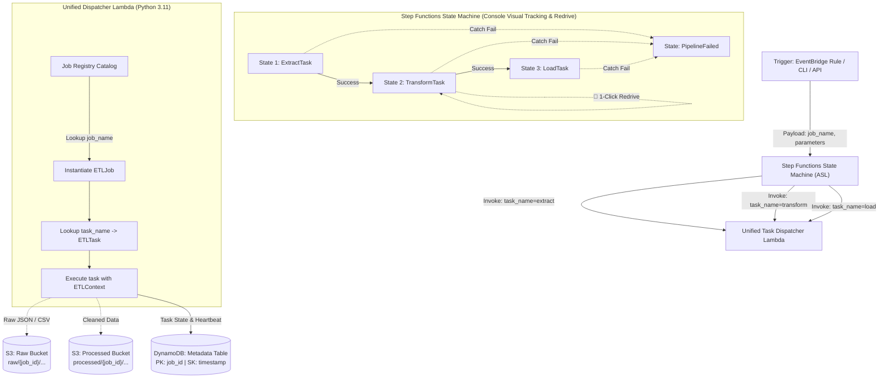

# Serverless Python ETL Framework: Architecture & Design

## 1. Executive Summary & Core Decisions

This document defines the production architectural design for an extensible, serverless Python ETL framework deployed on AWS (and emulated locally on LocalStack).

### Key Architectural Decisions

1. **Step Functions as Workflow Orchestrator**:
   - Every task in a job is represented as an explicit state in an **Amazon States Language (ASL)** state machine.
   - Provides granular visual execution history in the AWS / LocalStack web console.
   - Enables native **1-Click Redrive**: If any task fails, engineers can click "Redrive" directly in the management console to restart execution from the failed task without re-running earlier tasks.
   - Handles multi-job dependencies, branching, parallel fan-out, and failure catches natively.

2. **Unified Task Dispatcher Lambda (No Micro-Lambda Sprawl)**:
   - Instead of deploying separate AWS Lambda functions for each step, a **single unified Lambda function** hosts the framework, task runner, and all registered job classes.
   - Step Functions invokes this unified dispatcher with `{ "job_name": "...", "task_name": "..." }`.

3. **In-Memory Job Registry with Auto-Discovery**:
   - Jobs are written as standard Python classes decorated with `@register_job("job_name")`.
   - Jobs are automatically discovered and loaded into memory on container startup via Python's package inspection.

4. **Stateless Compute with S3 Pointers & DynamoDB Auditing**:
   - Step Functions passes lightweight metadata pointers (`job_id`, `raw_s3_key`, `processed_s3_key`) to remain well below the 256 KB Step Functions payload limit.
   - Data payloads are persisted directly to S3 partitioned by `job_id`.
   - Lifecycle state and execution metrics are recorded in DynamoDB under on-demand billing.

---

## 2. High-Level Architecture Diagram

> [!NOTE]
> An interactive, presentation-ready component diagram is saved at [architecture_diagram.html](file:///Users/kenny/projects/etl_framework/docs/architecture_diagram.html).



---

## 3. Amazon States Language (ASL) Specification

The state machine is defined in Amazon States Language in `terraform/asl/etl_pipeline.asl.json` and provisioned via Terraform:

```json
{
  "Comment": "Serverless ETL Pipeline orchestrated by Step Functions with Unified Task Dispatcher",
  "StartAt": "ExtractTask",
  "States": {
    "ExtractTask": {
      "Type": "Task",
      "Resource": "arn:aws:states:::lambda:invoke",
      "Parameters": {
        "FunctionName": "${lambda_arn}",
        "Payload": {
          "job_name.$": "$.job_name",
          "task_name": "extract",
          "job_id.$": "$.job_id",
          "parameters.$": "$.parameters",
          "context.$": "$.context"
        }
      },
      "ResultSelector": {
        "statusCode.$": "$.Payload.statusCode",
        "job_id.$": "$.Payload.job_id",
        "job_name.$": "$.Payload.job_name",
        "task_name.$": "$.Payload.task_name",
        "parameters.$": "$.Payload.parameters",
        "context.$": "$.Payload.context",
        "metrics.$": "$.Payload.metrics"
      },
      "Retry": [
        {
          "ErrorEquals": [
            "Lambda.ServiceException",
            "Lambda.AWSLambdaException",
            "Lambda.SdkClientException"
          ],
          "IntervalSeconds": 2,
          "MaxAttempts": 2,
          "BackoffRate": 2.0
        }
      ],
      "Catch": [
        {
          "ErrorEquals": ["States.ALL"],
          "ResultPath": "$.error",
          "Next": "PipelineFailed"
        }
      ],
      "Next": "TransformTask"
    },
    "TransformTask": {
      "Type": "Task",
      "Resource": "arn:aws:states:::lambda:invoke",
      "Parameters": {
        "FunctionName": "${lambda_arn}",
        "Payload": {
          "job_name.$": "$.job_name",
          "task_name": "transform",
          "job_id.$": "$.job_id",
          "parameters.$": "$.parameters",
          "context.$": "$.context"
        }
      },
      "ResultSelector": {
        "statusCode.$": "$.Payload.statusCode",
        "job_id.$": "$.Payload.job_id",
        "job_name.$": "$.Payload.job_name",
        "task_name.$": "$.Payload.task_name",
        "parameters.$": "$.Payload.parameters",
        "context.$": "$.Payload.context",
        "metrics.$": "$.Payload.metrics"
      },
      "Retry": [
        {
          "ErrorEquals": [
            "Lambda.ServiceException",
            "Lambda.AWSLambdaException",
            "Lambda.SdkClientException"
          ],
          "IntervalSeconds": 2,
          "MaxAttempts": 2,
          "BackoffRate": 2.0
        }
      ],
      "Catch": [
        {
          "ErrorEquals": ["States.ALL"],
          "ResultPath": "$.error",
          "Next": "PipelineFailed"
        }
      ],
      "Next": "LoadTask"
    },
    "LoadTask": {
      "Type": "Task",
      "Resource": "arn:aws:states:::lambda:invoke",
      "Parameters": {
        "FunctionName": "${lambda_arn}",
        "Payload": {
          "job_name.$": "$.job_name",
          "task_name": "load",
          "job_id.$": "$.job_id",
          "parameters.$": "$.parameters",
          "context.$": "$.context",
          "is_final": true
        }
      },
      "ResultSelector": {
        "statusCode.$": "$.Payload.statusCode",
        "job_id.$": "$.Payload.job_id",
        "job_name.$": "$.Payload.job_name",
        "task_name.$": "$.Payload.task_name",
        "context.$": "$.Payload.context",
        "metrics.$": "$.Payload.metrics"
      },
      "Retry": [
        {
          "ErrorEquals": [
            "Lambda.ServiceException",
            "Lambda.AWSLambdaException",
            "Lambda.SdkClientException"
          ],
          "IntervalSeconds": 2,
          "MaxAttempts": 2,
          "BackoffRate": 2.0
        }
      ],
      "Catch": [
        {
          "ErrorEquals": ["States.ALL"],
          "ResultPath": "$.error",
          "Next": "PipelineFailed"
        }
      ],
      "End": true
    },
    "PipelineFailed": {
      "Type": "Fail",
      "Cause": "ETL Task Execution Failed",
      "Error": "ETLTaskExecutionError"
    }
  }
}
```

---

## 4. Single ASL vs. Dedicated ASLs

The framework supports two ASL operational models:

1. **One Generic ASL for Standard Jobs (Default)**:
   - Because `"job_name.$": "$.job_name"` is passed dynamically in the ASL parameters, any job matching the standard 3-task pattern (`extract` ➔ `transform` ➔ `load`) runs on the **same single Step Functions state machine**.
   - Adding new standard jobs in Python requires **zero Terraform changes**.

2. **Dedicated ASL per Bespoke Job**:
   - For jobs that require unique, non-linear workflows (parallel branches, `Choice` condition states, or different task names), a dedicated `<job_name>.asl.json` file is placed in `terraform/asl/`.
   - All state machines invoke the **same single Lambda dispatcher**.

---

## 5. Core Python Framework Abstractions

```
src/
├── framework/
│   ├── __init__.py
│   ├── base.py          # ETLTask & ETLJob abstract classes
│   ├── context.py       # ETLContext runtime & AWS S3/DynamoDB adapters
│   ├── registry.py      # In-memory JobRegistry catalog & @register_job decorator
│   └── dispatcher.py    # Dispatches task calls, handles timing & DynamoDB updates
├── jobs/                # User-defined jobs
│   ├── __init__.py      # Auto-discovery module
│   └── customer_orders.py
└── lambda_dispatcher.py # Main AWS Lambda entrypoint
```

### 5.1. `ETLTask`
The atomic unit of execution:
```python
class ETLTask(ABC):
    name: str = "base_task"
    max_retries: int = 2
    backoff_seconds: float = 1.0

    @abstractmethod
    def execute(self, context: ETLContext) -> Dict[str, Any]:
        """Executes task logic and returns updated context dictionary."""
        pass
```

### 5.2. `ETLJob` & `JobRegistry`
Jobs define an ordered task list and register via a decorator:
```python
@register_job("customer_orders")
class CustomerOrdersJob(ETLJob):
    description = "Ingests customer orders, cleans currency, and calculates totals"
    tasks = [
        ExtractOrdersTask(),
        CleanseOrdersTask(),
        LoadSummaryTask()
    ]
```

### 5.3. `ETLContext`
Passed between tasks by the Step Functions state payload:
- **`context.get(key)` / `context.set(key, value)`**: Inter-task in-memory state.
- **`context.save_s3(key, data, bucket_type)`**: Serializes datasets to S3.
- **`context.read_s3(key, bucket_type)`**: Loads datasets from S3.
- **`context.record_metric(metric, value)`**: Audits metrics in DynamoDB.

---

## 6. Horizontal Scaling & Concurrency Characteristics

The combination of Step Functions, Lambda, S3, and DynamoDB forms a fully serverless, horizontally scaling data pipeline:

| Dimension | Scaling Architecture | Limits & Capacity |
| :--- | :--- | :--- |
| **Workflow Orchestration** | Step Functions Standard Workflows | Up to **1,000,000+** open concurrent executions; **10,000** state transitions/sec |
| **Compute Execution** | AWS Lambda auto-scaling | 1,000 concurrent executions (default soft limit, expandable to 10,000s) |
| **State Storage (Audit)** | DynamoDB On-Demand (PK: `job_id`) | Auto-scales up to 40,000+ Write Request Units/sec; zero hot-partitions |
| **Payload Storage** | S3 prefix partitioning (`{job_id}/`) | 3,500 PUT and 5,500 GET requests/sec per prefix |
| **Intra-Job Parallelism** | Step Functions Distributed Map | Up to **10,000 concurrent Lambda workers** per single execution |

### Best Practice: The 256 KB Payload Rule
AWS Step Functions enforces a **256 KB hard limit** on the JSON state passed between steps.  
Our framework adheres strictly to this rule:
- **Data Payloads**: Saved to S3 (`raw/{job_id}/data.json`, `processed/{job_id}/data.json`).
- **State Payload**: Only lightweight pointers (`job_id`, `raw_s3_key`, `processed_s3_key`, `record_count`) are passed through Step Functions.

---

## 7. Rerun & Redrive Operational Playbook

### 1-Click Management Console Redrive
1. Open [app.localstack.cloud](https://app.localstack.cloud/) (or AWS Management Console) ➔ **Step Functions**.
2. Click the failed execution (e.g. `exec-job-0623ef41`).
3. The visual graph highlights the exact task that failed in **red**.
4. Click the **"Redrive execution"** button in the console header.
5. Step Functions re-executes **only from the failed state**, preserving all prior task inputs and outputs.

### Programmatic CLI Invocation
Trigger any registered job with custom parameters from the command line:
```bash
make test-etl
# Or for a specific job:
make run-job JOB=customer_orders PARAMS='{"limit": 500}'
```

List all available jobs discovered in the Lambda catalog:
```bash
make list-jobs
```

Query all historical job runs and statuses from DynamoDB:
```bash
make query-ddb
```

---

## 8. Architectural Comparison: Serverless Framework vs. Apache Airflow

The table below contrasts this serverless framework (Step Functions + Lambda Dispatcher + S3 Data Pointer Pattern + DynamoDB) against traditional Apache Airflow (self-hosted or managed via AWS MWAA / Astronomer):

### 8.1. Comparison Matrix

| Dimension | This Framework (Step Functions + Lambda) | Apache Airflow (Self-Hosted / MWAA) |
| :--- | :--- | :--- |
| **Infrastructure & Ops** | ✅ **Serverless**: Zero server/cluster management. AWS manages scheduling, scaling, and state persistence natively. | **Cluster-based**: Requires Scheduler, Webserver, Metadata DB (PostgreSQL), and Worker pool (Celery/K8s/ECS). |
| **Idle Cost** | ✅ **\$0.00**: 100% pay-per-invocation (Lambda ms, Step Functions state transitions, DynamoDB on-demand). | **High baseline**: AWS MWAA starts at `~$350+/month` idle; self-hosted requires running EC2/EKS nodes 24/7. |
| **Scaling & Latency** | ✅ **Instant & Event-Driven**: Sub-second trigger via EventBridge/API; auto-scales to 1,000s of concurrent workers. | **Batch & Polling-based**: Scheduler evaluates DAG loops (seconds to minutes latency). Poor fit for real-time/streaming. |
| **Execution Limits** | **Hard Constraints**: 15-minute Lambda timeout, 10 GB RAM, 10 GB `/tmp`, 256 KB SFN state payload limit. | ✅ **Unconstrained**: Tasks can run for hours/days with arbitrary memory, disk, or GPU resources (e.g., via `KubernetesPodOperator`). |
| **DAG Definition** | **Hybrid / ASL**: Python `@register_job` for standard 3-task jobs; bespoke branching requires Amazon States Language (ASL) / Terraform. | ✅ **Pure Python DAGs**: Infinite programmatic flexibility (dynamic DAG generation, complex task branching, task groups). |
| **Ecosystem & Connectors** | **Lightweight / Custom**: Custom Python classes using `boto3` or direct client libraries. | ✅ **Massive Ecosystem**: Hundreds of pre-built provider packages (Snowflake, Databricks, BigQuery, dbt, Trino, Slack). |
| **Backfilling & Time-Travel** | **Manual**: Triggered via CLI/EventBridge script with custom date parameters. | ✅ **First-Class Primitive**: Native data interval backfilling (`catchup=True`, historical execution dates). |
| **Failure Recovery** | ✅ **Step Functions Redrive**: Native 1-click rerun from failed task; DynamoDB state checkpointing. | **Task / DAG Clear**: Rerun individual failed tasks, downstream tasks, or entire DAG runs from the UI. |

### 8.2. Decision Framework

- **Choose this Serverless Design when:**
  - Tasks complete within the **15-minute Lambda window** with moderate compute/memory requirements.
  - Workloads are **event-driven** (e.g., triggering immediately upon S3 upload or webhook event) or bursty micro-batches.
  - Minimizing operational overhead and eliminating idle infrastructure costs (\$0 idle cost) are key priorities.
  - You operate primarily within the AWS ecosystem.

- **Choose Apache Airflow when:**
  - Workloads require **long-running computations** (e.g., multi-hour PySpark/EMR jobs, heavy dbt runs against warehouses).
  - You have **complex, multi-tier DAG topologies** with dynamic task generation and cross-pipeline dependencies.
  - You need **native historical backfilling** over arbitrary calendar intervals and enterprise metadata/lineage integration (OpenLineage, Marquez).

