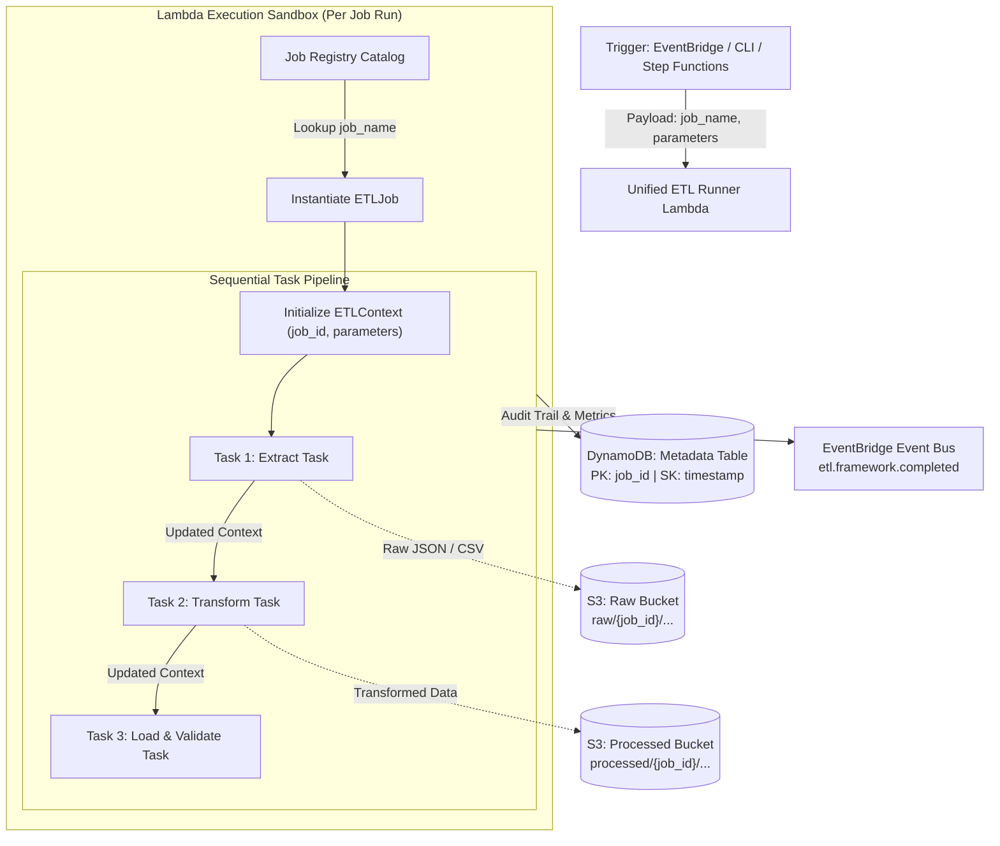

# Serverless Python ETL Framework: Architecture & Design

## 1. Executive Summary & Objectives

This document defines the architectural design for a simplified, extensible, Python-native ETL framework deployed on AWS serverless infrastructure (emulated locally via LocalStack).

### Primary Goals

1. **Python-Centric Developer Experience**: Data engineers write standard Python classes for jobs and tasks with clean abstractions.
2. **Simplified Infrastructure**: A single **Unified Lambda Runner** hosts and executes all registered ETL jobs, eliminating the complexity and deployment overhead of micro-lambdas per task.
3. **Pluggable Job Registry**: New ETL jobs are declared, decorated (`@register_job`), and dynamically discovered at runtime without modifying infrastructure code.
4. **Task-Composed Workflows**: A job is composed of discrete, reusable `ETLTask` units (e.g., Extract, Transform, Validate, Load) executed sequentially within the Lambda execution context.
5. **Auditing & State Persistence**: Comprehensive lifecycle tracking in DynamoDB with automated S3 storage partitioning for raw and processed datasets.
6. **Concurrent & Isolated**: Native horizontal auto-scaling where concurrent jobs run in separate Lambda execution sandboxes with zero state leakage.

---

## 2. High-Level Architecture Diagram



---

## 3. Core Framework Abstractions

The framework is organized into five decoupled abstractions:

```
src/
├── framework/
│   ├── base.py          # Abstract ETLTask & ETLJob definitions
│   ├── context.py       # Runtime ETLContext & AWS service adapters
│   ├── registry.py      # Job catalog & @register_job decorator
│   └── runner.py        # Lifecycle orchestration, error handling, and auditing
├── jobs/                # User-defined ETL jobs
│   ├── customer_orders.py
│   └── user_metrics.py
└── lambda_runner.py     # Main AWS Lambda entrypoint
```

### 3.1. `ETLContext` (Runtime Environment)
An instance of `ETLContext` is created for each execution and passed down through each task:
- **Metadata**: Carries `job_id`, `job_name`, `parameters`, and `start_time`.
- **Inter-Task State**: Provides `context.set(key, value)` and `context.get(key)` for passing intermediate data in-memory between tasks.
- **Storage Helpers**:
  - `context.save_s3(key, data, bucket_type="raw"|"processed")`
  - `context.read_s3(key, bucket_type="raw"|"processed")`
- **Metrics**: Allows recording task-level statistics (`context.record_metric("rows_processed", 120)`).

### 3.2. `ETLTask` (Atomic Unit of Work)
Every discrete step inherits from `ETLTask`:
```python
class ETLTask:
    name: str = "task_name"
    
    def execute(self, context: ETLContext) -> Any:
        """Executes the task logic using the provided context."""
        raise NotImplementedError
```

### 3.3. `ETLJob` (Workflow Pipeline)
A job encapsulates metadata and an ordered sequence of tasks:
```python
class ETLJob:
    name: str
    description: str = ""
    tasks: list[ETLTask] = []
```

### 3.4. `JobRegistry` (Dynamic Discovery)
Jobs register themselves via a decorator:
```python
@register_job("customer_orders")
class CustomerOrdersJob(ETLJob):
    description = "Ingests customer transactions, cleans currencies, and aggregates totals"
    tasks = [ExtractOrdersTask(), CleanseOrdersTask(), LoadSummaryTask()]
```
The registry enables:
- Looking up a job by string identifier (`JobRegistry.get("customer_orders")`).
- Discovering all available jobs (`JobRegistry.list_jobs()`).

### 3.5. `JobRunner` (Lifecycle & Auditing Manager)
The runner executes a job end-to-end:
1. Generates a unique `job_id` (UUID).
2. Writes an initial `PENDING` / `IN_PROGRESS` record to DynamoDB.
3. Loops through each task in `job.tasks`:
   - Records task start timestamp.
   - Executes `task.execute(context)`.
   - Records task duration, status, and task-specific metrics.
4. **Error Handling**: If an unhandled exception occurs in any task:
   - Captures the exact exception type and formatted stack trace.
   - Marks the job and failing task as `FAILED` in DynamoDB.
   - Re-raises or exits cleanly with error details.
5. **Success Finalization**: Marks the job as `COMPLETED` in DynamoDB and publishes an `ETLJobCompleted` event to EventBridge.

---

## 4. Invocation & Event Interfaces

The single Lambda handler accepts standardized JSON payloads from any trigger source (EventBridge rules, Step Functions, or direct SDK invocations):

### Triggering an ETL Job
```json
{
  "job_name": "customer_orders",
  "parameters": {
    "date_range": "2026-11-01",
    "batch_size": 500,
    "dry_run": false
  }
}
```

### Listing Registered Jobs
```json
{
  "action": "list_jobs"
}
```

---

## 5. Concurrency & Scaling Architecture (Without SQS)

Without introducing SQS queues, the framework relies on native serverless horizontal scaling:

```
Incoming Concurrency (e.g. 100 Jobs Triggered at 12:00:00)
    │
    ├── Job A, Run 1 ──► Lambda Instance 1 (job_id: job-a1) ──► S3 (raw/job-a1/...) ──► DynamoDB (PK: job-a1)
    ├── Job A, Run 2 ──► Lambda Instance 2 (job_id: job-a2) ──► S3 (raw/job-a2/...) ──► DynamoDB (PK: job-a2)
    ├── Job B, Run 1 ──► Lambda Instance 3 (job_id: job-b1) ──► S3 (raw/job-b1/...) ──► DynamoDB (PK: job-b1)
    └── Job C, Run 1 ──► Lambda Instance 4 ──► ...
```

### 5.1. Compute Isolation
- **Process & Memory Isolation**: Each invocation spawns or reuses an isolated Lambda microVM container. State from Job A cannot leak into Job B.
- **Horizontal Scaling**: AWS Lambda automatically scales up to the account's unreserved concurrency limit (default 1,000 concurrent executions).

### 5.2. Zero Hot-Partitioning in DynamoDB
- The DynamoDB tracking table uses `job_id` (UUID) as the **Partition Key** (`HASH`) and `timestamp` as the **Sort Key** (`RANGE`).
- Because UUIDs are evenly distributed, concurrent writes never hit partition throttling.
- Using `PAY_PER_REQUEST` (On-Demand Capacity) allows DynamoDB to scale from 0 to tens of thousands of requests per second instantly.

### 5.3. S3 Throughput Distribution
- Intermediate task storage and final datasets are partitioned by job:
  - `s3://etl-framework-raw-dev/raw/{job_id}/...`
  - `s3://etl-framework-processed-dev/processed/{job_id}/...`
- AWS S3 natively supports 3,500 PUT and 5,500 GET requests per second per prefix. Partitioning by `{job_id}` guarantees that concurrent jobs never bottleneck each other on object storage.

---

## 6. DynamoDB Audit Schema

Each job execution creates and updates a record in DynamoDB:

| Attribute | Type | Description | Example |
| :--- | :--- | :--- | :--- |
| `job_id` | `S` (PK) | Unique run identifier | `job-8f92b1a0` |
| `timestamp` | `S` (SK) | ISO-8601 creation time | `2026-11-07T22:30:00.000Z` |
| `job_name` | `S` | Name of registered job | `customer_orders` |
| `status` | `S` | Current status | `IN_PROGRESS`, `COMPLETED`, `FAILED` |
| `duration_ms` | `N` | Total runtime in ms | `1420` |
| `parameters` | `M` | Invocations parameters | `{"batch_size": 500}` |
| `task_history` | `L` | Step-by-step task breakdown | `[{"task": "extract", "status": "COMPLETED", "duration_ms": 320}]` |
| `metrics` | `M` | User-defined job metrics | `{"records_in": 500, "records_out": 492}` |
| `error` | `M` | Error details (if failed) | `{"task": "cleanse", "type": "ValueError", "message": "..."}` |
| `updated_at` | `S` | Last heartbeat/update | `2026-11-07T22:30:01.420Z` |

---

## 7. Future Evolution Path (When Scale Demands It)

When workloads expand in the future, the design can be extended without breaking existing jobs:

1. **Downstream Rate Limiting (SQS Buffer)**:
   If downstream APIs or databases have connection pools or rate limits, an SQS queue can be placed in front of the Lambda runner to throttle maximum concurrency (e.g. `maximum_concurrency: 20`).
2. **Long-Running Compute (>15 Minutes)**:
   Because job logic is decoupled into `ETLJob` and `ETLTask`, the exact same Python classes can be executed inside **AWS ECS Fargate** or **AWS Batch** for jobs that exceed the Lambda 15-minute timeout.
3. **Directed Acyclic Graphs (DAGs)**:
   The task list in `ETLJob` can evolve from a sequential array into a directed dependency graph if branching or parallel tasks inside a single job are required.
